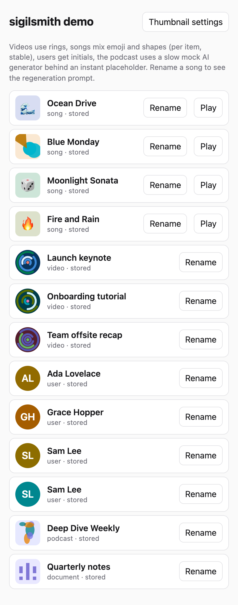

# sigilsmith

Deterministic identity images (identicons, avatars, thumbnails, favicons) for every item in your app's lists, generated in the browser, stable across reloads, devices and deploys.

```bash
npm i sigilsmith && npx sigilsmith init --samples items.json && npx sigilsmith build
```
```tsx
import { sigil } from './sigilsmith.gen';  import { SigilProvider, Sigil } from 'sigilsmith/react';
<SigilProvider sigil={sigil}> … <Sigil item={song} size={40} /> … </SigilProvider>
```



## What it is

sigilsmith is a *builder* package. You (or, more often, your coding agent) use its CLI to choose generators from a catalog, preview them on your own items, pin the choice in one config file, and generate a small wiring module your app imports. What reaches the browser is a ~4.2 kB gzip kernel plus only the generators you chose (0.6–2.1 kB each), each lazily loaded.

- **One source of truth.** `sigilsmith.config.json` decides the item key, which fields feed each generator, which generator draws which items, params, budgets and integration targets. App code never names a field or a generator; renaming a data field is a one-line config change, and `sigilsmith check` tells you which line.
- **Same item, same image.** Generators are seeded from the item's inputs, never from `Math.random`. Each generator major (`grid@1`) is frozen: output changes ship as a new major you opt into. A lock file records what your sample items look like, and `check` fails if anything would change them.
- **Agent-first.** Every command prints one JSON envelope with `--json`; every problem is a stable `SGS` code with a fix (often a machine-applicable edit). `AGENTS.md` and a bundled skill tell agents the loop: choose, preview, pin, build, glue, check.

## The commands

| Command | Does |
|---|---|
| `init [--samples f]` | starter config (key detected from your samples) and an `AGENTS.md` block |
| `catalog [--style … --max-gzip N --no-network --implemented]` (`--max-gzip` is per generator) | the menu: 7 implemented generators, the screenshot extra and 61 surveyed technologies, filtered by your constraints, with reasons for exclusions |
| `preview [--generators a@1,b@1]` | contact sheet (items × 16/32/64/128 px × light/dark) as HTML and PNG, plus near-duplicate metrics |
| `detect-key <samples> [--write]` | finds the field (or composite) that identifies items; flags unstable choices |
| `explain [--index N]` | for an item: key, generator and the rule that chose it, inputs, and the layer every param came from |
| `build [--accept]` | writes the wiring module and the lock |
| `targets [--emit]` | favicon, Apple touch icon, manifest icons, og:image, Media Session art: files and snippets |
| `check` | config, freshness, data drift, identity, determinism, budget, peers, bypass, target registration |
| `adopt [--dirs src]` | finds an app's own thumbnail code (hand-rolled orbs and identicons, avatar libraries, hand-set lock-screen art) and per-item image URLs, with call sites, and returns the migration recipe |
| `mcp` | the same operations as MCP tools over stdio (`claude mcp add sigilsmith -- npx sigilsmith mcp`); `preview` returns the sheet as an image |

## Generators (implemented)

| ref | style × semantics | gzip (incremental) | notes |
|---|---|---|---|
| `grid@1` | geometric × hash | 626 B | mirrored grid identicon, in-house |
| `rings@1` | abstract × hash | 586 B | concentric arcs, in-house |
| `shapes@1` | abstract × hash | 699 B | Bauhaus shapes, in-house |
| `aura@1` | abstract × hash | 1.4 kB | blurred colour fields on a dark base: the gradient "orb" media apps hand-roll; seeded by cyrb53 of the key like those, so a migrated app keeps each item's colours |
| `initials@1` | geometric × metadata | 786 B | letters from the label, colour from the key |
| `emoji@1` | illustrative × metadata | 1429 B | keyword match on title/tags, else hash |
| `glyph@1` | geometric × metadata | ~2.1 kB | feature glyph: hue, shape, fill, rings, orbit, mark, tone and size are params a feature mapping drives |
| `minidenticons@1` | geometric × hash | 695 B | adapter over the MIT `minidenticons` (peer, pinned 4.2.1) |
| `screenshot@1` (extra) | illustrative × metadata | 2.3 kB | the item's key screenshot, cropped to the region that identifies it (`screenshotFocus`), with a sigil when there is none; `sigilsmith/extras/screenshot/v1`, [details](skills/sigilsmith/references/screenshot.md) |
| remote (`proxy`, `module`/BYOK, `dicebear`, `mock`) | any | 2.7 kB module | cached by content id, instant placeholder, keys never in the bundle; the public DiceBear API is free for non-commercial use only (`check` warns until you acknowledge it or self-host) |

Measured with esbuild + gzip -9 on 2026-11-23 (`npm run measure`); third-party libraries are measured in `spikes/README.md`.

## Migrating an app's own thumbnails

`npx sigilsmith adopt` lists what the app draws itself and how to replace each piece with minimum disruption: the generator with the same look and the old palette pinned (`aura@1` keeps a cyrb53 gradient orb's colours exactly), `mediaArtwork` (`sigilsmith/targets`) for lock-screen art, `adoptImage` for images items already have, and per-item choice (upload, or pick among candidates such as provider cover art) with `useSigilPicker` / `<SigilPicker>` from `sigilsmith/react`, stored through any zodal blob provider. Recipe: [references/migrating.md](skills/sigilsmith/references/migrating.md).

## Feature-driven sigils

Identicons make items look *different*; a feature set makes them look *meaningfully* different, so similar items look related. Three JSON files, maintained without code: a **schema** of dimensions (`numeric`, `ordinal`, `categorical`, `binary`), the items' **vectors** (on the item or in a table by key), and a **mapping** from dimensions to a generator's params.

```jsonc
"features": [{ "when": { "kind": "instrument" }, "schema": "instrument.features.schema.json", "mapping": "instrument.sigil-mapping.json" }]
```
```json
{ "use": "glyph@1", "encodings": { "glyph@1": {
  "hue":   { "from": "family", "map": { "wind": 190, "string": 30, "percussion": 350 } },
  "orbit": { "from": "voices", "range": [0, 6], "round": true },
  "mark":  { "from": "percussive", "map": { "true": "pulse", "false": "none" } } } } }
```

The encoded params are a plan layer of their own (`explain` shows the dimension behind each), `check` reports vectors that do not fit the schema and features the mapping cannot show, and the browser loads `sigilsmith/features` (~1.1 kB) only when a config uses it. The mapping is keyed by generator, so the same features can drive a remote style (DiceBear options) with no code. Guide: [`skills/sigilsmith/references/features.md`](skills/sigilsmith/references/features.md).

## Policies, settings, delivery

```jsonc
"policy": {
  "default": "grid@1",
  "rules": [
    { "when": { "type": "video" }, "use": "rings@1" },
    { "when": { "type": "song" }, "use": { "emoji@1": 1, "shapes@1": 1 } }   // deterministic per item
  ]
},
"userSettings": { "choices": ["grid@1", "rings@1", "shapes@1"] },          // end users may pick among these
"delivery": { "strategy": "derived" },                                      // or "materialized" / "hybrid"
"regeneration": { "policy": "auto" }                                        // generator default (initials: always), else ask; or "ask" / "always" / "never"
```

- **Delivery**: `materialized` renders once in the browser and stores the file (content-addressed, through any `@zodal/store` blob provider via `sigilsmith/zodal`); `derived` renders on every view and stores nothing; `hybrid` does both.
- **Regeneration**: when an item's generator inputs change (an identicon keyed on an id never does), `ask` shows a non-modal "update the image?" prompt that defaults to keep. Custom images are never overwritten.
- **End-user settings**: `sigilsmith/zodal/settings` turns `userSettings` into a zodal-dials definition, rendered by any dials panel. Load it lazily (it brings zod and dials).

## Example

`examples/demo` is a Vite + React app with songs, videos, users and a podcast: a type-based policy, a weighted mix, a slow mock AI generator behind a placeholder, stored images through a zodal provider, the rename prompt, the settings panel and favicons. `cd examples/demo && npm i && npm run sigils && npm run dev`; `node e2e/smoke.mjs` drives it in Chrome.

## Documentation

- Design: [`docs/design/proposal.md`](docs/design/proposal.md).
- Research: [`docs/research/`](docs/research/): identity and memory (background), distribution model, agent-first design, generator survey, integration and delivery, zodal fit.
- Agents integrating sigilsmith: [`skills/sigilsmith/SKILL.md`](skills/sigilsmith/SKILL.md). Agents developing it: [`AGENTS.md`](AGENTS.md).

MIT © Thor Whalen
